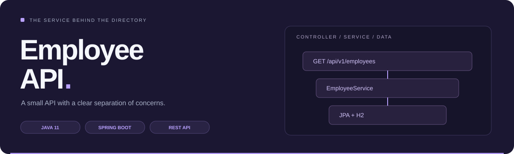

<div align="center">

**The Java backend behind Employee Manager.**

[Complete project](https://github.com/KaiAlexander-commits/Employee-Manager-Dashboard) · [Controller](src/main/java/com/chambers/employeemgrserver/domain/employee/controllers/EmployeeController.java) · [Run locally](#02--run-the-api)

</div>

---

## 01 / One half of the system

This repository contains the original Spring Boot employee API. The complete application now lives in [Employee-Manager-Dashboard](https://github.com/KaiAlexander-commits/Employee-Manager-Dashboard), with separate `frontend/` and `backend/` folders.

This standalone copy preserves the server's source and history.

| Layer | Technology |
| --- | --- |
| Runtime | Java 11 |
| HTTP | Spring Boot 2.7.1 / Spring Web |
| Persistence | Spring Data JPA / H2 |
| Model | Lombok |
| Build | Maven |

The API supports listing, creating, updating, deleting, and looking up employees by email. Each employee has an `id`, `firstName`, `lastName`, and `email`.

## 02 / Run the API

Install **JDK 11** and **Maven**, then:

```bash
git clone https://github.com/KaiAlexander-commits/Employee-Manager-Server.git
cd Employee-Manager-Server
mvn spring-boot:run
```

Base URL: **http://localhost:8080/api/v1/employees**

The database uses embedded H2 with the current Spring Boot defaults. No external database setup is required. Records are temporary and do not survive restarts.

## 03 / The contract

Paths below are relative to the base URL.

| Method | Path | Operation | Success response |
| --- | --- | --- | --- |
| GET | Base URL | List employees | 200 |
| POST | Base URL | Create employee | 201 |
| GET | `/{id}` | Retrieve employee | 200 |
| PUT | `/{id}` | Update employee | 202 |
| DELETE | `/{id}` | Delete employee | 204 |
| GET | `/lookup?email={email}` | Find employee by email | 200 |

```bash
curl -X POST http://localhost:8080/api/v1/employees \
  -H "Content-Type: application/json" \
  -d '{"firstName":"Alex","lastName":"Taylor","email":"alex@example.com"}'
```

The database generates the employee ID.

## 04 / Trace the request

| Layer | Code | Job |
| --- | --- | --- |
| Controller | [EmployeeController.java](src/main/java/com/chambers/employeemgrserver/domain/employee/controllers/EmployeeController.java) | Map HTTP requests to employee operations |
| Service | [EmployeeServiceImpl.java](src/main/java/com/chambers/employeemgrserver/domain/employee/services/EmployeeServiceImpl.java) | Create, retrieve, update, and delete records |
| Repository | [EmployeeRepository.java](src/main/java/com/chambers/employeemgrserver/domain/employee/repos/EmployeeRepository.java) | Access data through Spring Data |
| Entity | [Employee.java](src/main/java/com/chambers/employeemgrserver/domain/employee/models/Employee.java) | Define stored employee fields |
| Browser access | [WebConfig.java](src/main/java/com/chambers/employeemgrserver/domain/employee/controllers/WebConfig.java) | Allow the frontend's local origins |

## 05 / Development

```bash
mvn test
mvn package
```

The existing test checks that the application context loads. CORS allows `http://localhost:5174` and `http://localhost:4000`.

Application settings live in [application.properties](src/main/resources/application.properties). Authentication and authorization are not implemented; use sample employee data for local development.

---

<div align="center">

**Looking for the dashboard too?**

[Open the combined Employee Manager project →](https://github.com/KaiAlexander-commits/Employee-Manager-Dashboard)

</div>
